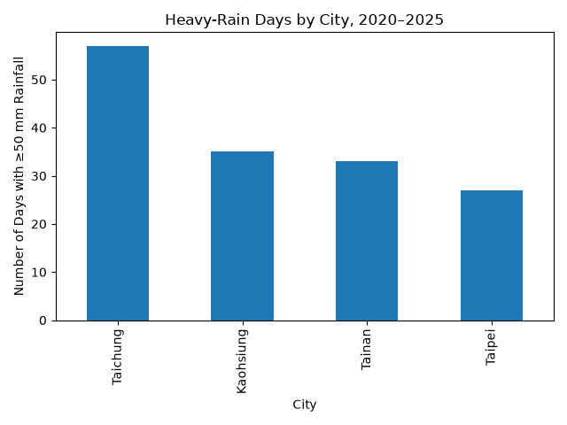
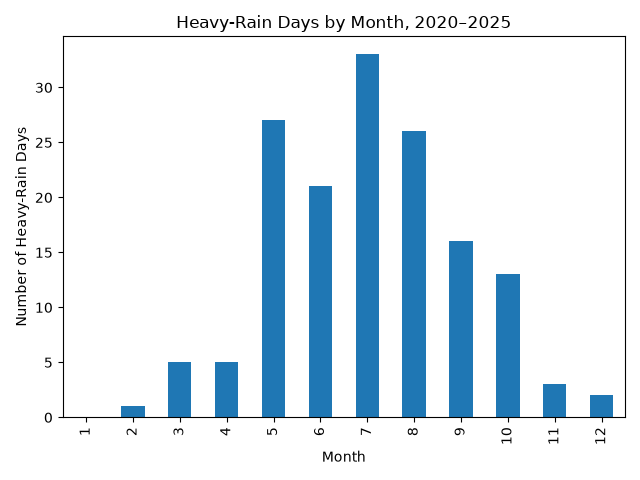
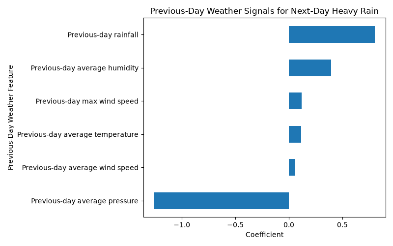

# Taiwan Weather & Rainfall Analysis

A Python data analysis project exploring heavy-rain patterns across Taipei, Taichung, Tainan, and Kaohsiung from 2020 to 2025 using historical weather data from Open-Meteo.

The project looks at two questions:
1. What weather conditions tend to be associated with heavy-rain days?
2. Can previous-day weather conditions help identify periods of elevated next-day heavy-rain risk?

## Why I Built This

My grandmother lives in Taiwan, and unpredictable periods of heavy rain can make everyday planning more difficult. That made me curious about whether historical weather data could reveal useful patterns around heavy rainfall.

As an MIS student, I also wanted to use this project to build on my Python and data-analysis skills by working with real API data, cleaning and organizing it, exploring weather patterns, and testing a simple next-day rainfall-risk model.

## Data Source
Historical weather data was collected from the Open-Meteo Historical Weather API, which provides hourly weather observations without requiring an API key.

The analysis covers four major cities in Taiwan:
- Taipei
- Taichung
- Tainan
- Kaohsiung

Hourly variables collected:
- precipitation
- temperature
- relative humidity
- surface pressure
- wind speed
- weather code

The hourly observations were later aggregated into daily city-level data for analysis.

For this project, a heavy-rain day was defined as a day with at least 50 mm of total rainfall.

## Methods

The project was completed in four main steps:

1. Collected hourly historical weather data for four Taiwanese cities using the Open-Meteo Historical Weather API.
2. Cleaned the data and aggregated hourly observations into daily city-level features.
3. Compared normal days and heavy-rain days to identify differences in humidity, pressure, wind speed, temperature, and rainfall.
4. Built a logistic regression model to estimate next-day heavy-rain risk using only previous-day weather conditions.

To make the forecast evaluation more realistic, the model was trained on data from 2020 through 2024 and tested on 2025 data.

The model only used weather information available from the previous day, preventing same-day conditions from leaking into the next-day prediction.

## Key Findings

From 2020 to 2025, the number of heavy-rain days varied across the four cities:

- Taichung: 57
- Kaohsiung: 35
- Tainan: 33
- Taipei: 27

Taichung had the highest number of heavy-rain days in the dataset.

Heavy-rain events also showed a clear seasonal pattern. July had the highest number of heavy-rain days, with most events concentrated between May and October.

Compared with normal days, heavy-rain days tended to have:
- higher humidity
- lower atmospheric pressure
- stronger winds

These patterns helped guide the variables used in the forecasting model.





## Forecast Model

A logistic regression model was built to estimate next-day heavy-rain risk using only previous-day weather conditions.

The model used:
- average temperature
- average humidity
- average pressure
- average wind speed
- maximum wind speed
- total rainfall

The model was trained on 2020 through 2024 data and evaluated on 2025 data.

### Model Performance

- ROC-AUC: 0.925
- Heavy-rain recall: 0.821
- Heavy-rain precision: 0.145
- Accuracy: 0.866

The model identified 32 of 39 heavy-rain events in the 2025 test set. It showed strong ability to rank higher-risk days above lower-risk days, with a ROC-AUC of 0.925. Precision remained relatively low because heavy-rain events were rare and the model still produced a substantial number of false positives.



## Limitations

- The analysis uses approximate city-center coordinates rather than weather observations covering each full metropolitan area.
- Heavy rain is defined using a fixed threshold of 50 mm of daily rainfall.
- Heavy-rain events are relatively rare in the dataset, which created class imbalance and contributed to low precision in the forecasting model.
- The model is intentionally simple and is meant to explore rainfall-risk patterns, not replace professional meteorological forecasting.
- The project does not directly model typhoon tracks or typhoon formation.

## Tools

- Python
- Pandas
- NumPy
- Matplotlib
- scikit-learn
- Open-Meteo Historical Weather API
- PyCharm

## Project Structure

```text
taiwan-weather-rainfall-analysis/
├── data/
│   ├── raw/
│   └── processed/
outputs/
    ├── forecast_model_coefficients.png
    ├── heavy_rain_by_city.png
    ├── heavy_rain_by_month.png
    └── heavy_rain_weather_differences.png
├── src/
│   ├── data_collection.py
│   ├── data_cleaning.py
│   ├── analysis.py
│   └── forecast_model.py
├── README.md
└── requirements.txt
```
